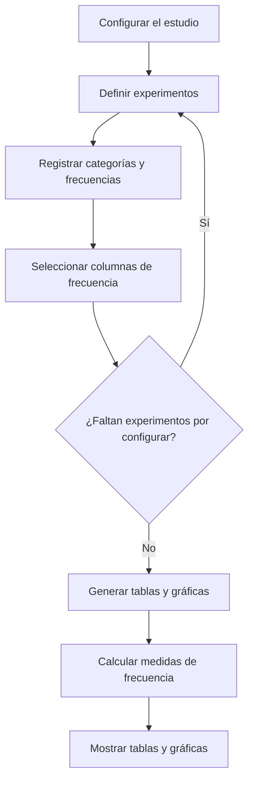

# Calculadora de Tablas de Frecuencia y Gráficas

Aplicación web académica que automatiza la construcción de tablas de distribución de frecuencias y la generación de gráficas de barras a partir de datos categóricos. Permite organizar, resumir y visualizar resultados de uno o varios experimentos o preguntas dentro de un mismo estudio.

## Demo en línea

Puedes probar la aplicación desde GitHub Pages:

**[Abrir Calculadora de Tablas de Frecuencia y Gráficas](https://migueldotdev.github.io/web-app-probabilidad/)**

## Tabla de contenidos

- [Presentación del proyecto](#presentación-del-proyecto)
- [Contexto académico](#contexto-académico)
- [Propósito y objetivos](#propósito-y-objetivos)
- [Fundamento conceptual](#fundamento-conceptual)
- [Funcionalidades principales](#funcionalidades-principales)
- [¿Cómo funciona?](#cómo-funciona)
- [Interpretación de resultados y gráficas](#interpretación-de-resultados-y-gráficas)
- [Tecnologías utilizadas](#tecnologías-utilizadas)
- [Estructura del proyecto](#estructura-del-proyecto)
- [Requisitos y ejecución](#requisitos-y-ejecución)
- [Ejemplo de uso](#ejemplo-de-uso)
- [Alcance y limitaciones](#alcance-y-limitaciones)
- [Autoría y créditos](#autoría-y-créditos)

## Presentación del proyecto

Esta aplicación permite crear un estudio, dividirlo en varios experimentos o preguntas y registrar las categorías —denominadas marcas o clases en la interfaz— junto con sus frecuencias absolutas. A partir de esos datos, genera tablas de frecuencia configurables y gráficas de barras.

Los resultados se presentan en una misma vista HTML para facilitar su consulta e interpretación. El proyecto se desarrolló como una actividad universitaria para la asignatura de Probabilidad y busca apoyar la comprensión práctica de la organización y representación de datos.

## Contexto académico

El proyecto fue desarrollado como parte de una actividad universitaria para la asignatura de **Probabilidad**. Por su implementación, el contenido matemático que aborda de forma directa es la **construcción de tablas de distribución de frecuencias**, un recurso de estadística descriptiva relacionado con la organización y el resumen de datos.

Aunque este tema se relaciona con el análisis de fenómenos estudiados en cursos de Probabilidad y Estadística, la aplicación no debe interpretarse como una calculadora general de probabilidades: sus cálculos principales se basan en las frecuencias que ingresa el usuario.

## Propósito y objetivos

**Propósito general:** facilitar la elaboración e interpretación de tablas de frecuencia mediante el cálculo automático de medidas descriptivas y su representación gráfica.

**Objetivos específicos:**

- Configurar un estudio con título y descripción opcional.
- Organizar varios experimentos o preguntas dentro de un mismo estudio.
- Definir las categorías o marcas de clase de cada experimento y registrar sus frecuencias absolutas.
- Seleccionar las columnas de frecuencia que se desean mostrar.
- Calcular y presentar frecuencias absolutas, relativas, porcentuales y acumuladas.
- Generar una gráfica de barras por experimento para visualizar las frecuencias absolutas.
- Reunir las tablas y gráficas en una misma vista.

## Fundamento conceptual

Una tabla de distribución de frecuencias resume cuántas veces aparece cada categoría o valor en un conjunto de datos.

Si \(f_i\) representa la frecuencia absoluta de la categoría \(i\), el total de observaciones se obtiene mediante:

\[
n = \sum_i f_i
\]

A partir de ese total, pueden calcularse las siguientes medidas:

- **Frecuencia absoluta (\(f_i\)):** cantidad de observaciones registradas en una categoría.
- **Frecuencia relativa (\(f_{r,i}\)):** proporción de observaciones de una categoría respecto al total.

  \[
  f_{r,i} = \frac{f_i}{n}
  \]

- **Frecuencia relativa porcentual (\(f_{p,i}\)):** frecuencia relativa expresada como porcentaje.

  \[
  f_{p,i} = f_{r,i} \times 100\%
  \]

- **Frecuencia absoluta acumulada (\(F_i\)):** suma de las frecuencias absolutas hasta la categoría \(i\), siguiendo el orden de las filas.

  \[
  F_i = \sum_{k=1}^{i} f_k
  \]

- **Frecuencia relativa acumulada (\(F_{r,i}\)):** suma de las frecuencias relativas hasta la categoría \(i\), siguiendo el mismo orden.

  \[
  F_{r,i} = \sum_{k=1}^{i} f_{r,k}
  \]

La aplicación permite elegir cuáles de estas medidas aparecen en la tabla. Las gráficas de barras representan las frecuencias absolutas de las categorías.

> **Nota:** las frecuencias acumuladas dependen del orden en que se ingresan las categorías. Su interpretación debe considerar ese orden, especialmente cuando se trabaja con categorías cualitativas.

## Funcionalidades principales

- **Configuración del estudio:** título obligatorio y descripción opcional.
- **Múltiples experimentos o preguntas:** configuración individual de cada elemento dentro del estudio.
- **Gestión de marcas o clases:** definición de categorías y sus frecuencias absolutas.
- **Columnas configurables:** selección de las medidas de frecuencia que se mostrarán.
- **Cálculo automático:** generación de totales, frecuencias relativas, porcentuales y acumuladas.
- **Gráficas de barras:** visualización de frecuencias absolutas por categoría mediante Chart.js.
- **Vista de resultados unificada:** presentación de las tablas y gráficas generadas en una misma sección HTML.

## ¿Cómo funciona?

1. **Configurar el estudio:** introducir un título, una descripción opcional y la cantidad de experimentos o preguntas.
2. **Configurar cada experimento:** seleccionar un experimento, asignarle un título y definir cuántas marcas o clases contendrá.
3. **Registrar las categorías:** para cada marca, indicar su nombre o etiqueta y la frecuencia absoluta correspondiente. La interfaz también contempla un campo de medida opcional.
4. **Elegir las columnas:** activar o desactivar las medidas de frecuencia que se mostrarán en la tabla.
5. **Aplicar la configuración:** guardar los cambios del experimento.
6. **Generar los resultados:** pulsar el control para crear las tablas y gráficas.
7. **Interpretar la salida:** consultar las frecuencias calculadas y las gráficas de barras de cada experimento.

### Diagrama de flujo



## Interpretación de resultados y gráficas

Cada experimento genera una tabla cuyas filas representan las marcas o categorías registradas. Las columnas visibles dependen de la configuración elegida por el usuario.

- **Frecuencia absoluta:** muestra la cantidad registrada para cada categoría.
- **Frecuencia relativa:** expresa la proporción de cada categoría respecto al total de frecuencias.
- **Frecuencia relativa porcentual:** muestra esa proporción en porcentaje.
- **Frecuencia absoluta acumulada:** suma las frecuencias absolutas de forma progresiva.
- **Frecuencia relativa acumulada:** suma las frecuencias relativas de forma progresiva.
- **Gráfica de barras:** utiliza las categorías como etiquetas del eje horizontal y las frecuencias absolutas como valores representados en el eje vertical.

Estas visualizaciones ayudan a comparar las cantidades registradas y a observar cómo se distribuyen los datos. La aplicación presenta los resultados; su interpretación depende del contexto y de la calidad de los datos ingresados.

## Tecnologías utilizadas

| Tecnología | Uso en el proyecto |
|---|---|
| HTML5 | Estructura de la interfaz y de los formularios. |
| CSS3 | Estilos y presentación visual. |
| Bootstrap 5.3.3 | Diseño adaptable y componentes de interfaz. |
| JavaScript (Vanilla) | Lógica de la aplicación, manejo de datos, cálculos y generación dinámica de resultados. |
| Chart.js 4.4.3 | Generación de gráficas de barras. |
| SweetAlert2 11 | Diálogos y mensajes de interacción. |
| jQuery | Uso puntual en la gestión del modal. |

Las bibliotecas de terceros se cargan desde CDN en `index.html`, salvo jQuery, que se encuentra localmente en `JS/JQuery.js`. El proyecto no requiere un gestor de paquetes para su ejecución según la estructura documentada.

## Estructura del proyecto

```text
web-app-probabilidad/
├── index.html
└── JS/
    ├── app.js
    ├── funciones-varias.js
    ├── validaciones.js
    └── JQuery.js
```

- **`index.html`:** contiene la interfaz, los formularios, el modal de edición y el área donde se presentan los resultados.
- **`JS/app.js`:** gestiona el flujo principal, mantiene los experimentos en memoria, calcula las frecuencias y genera las tablas y gráficas.
- **`JS/funciones-varias.js`:** contiene utilidades para el tratamiento y la representación de decimales periódicos.
- **`JS/validaciones.js`:** administra estados de controles y validaciones de entrada.
- **`JS/JQuery.js`:** contiene la copia local de jQuery utilizada por la aplicación.

## Requisitos y ejecución

### Requisitos previos

- Un navegador web moderno, como Firefox, Chrome, Edge o Safari.
- Conexión a internet para cargar Bootstrap, Chart.js y SweetAlert2 desde sus CDN.

No se requiere instalar Node.js, ejecutar un proceso de compilación ni configurar una base de datos para utilizar la versión estática documentada.

### Ejecutar localmente

1. Clona el repositorio:

   ```bash
   git clone <URL-DEL-REPOSITORIO>
   ```

2. Entra en el directorio descargado:

   ```bash
   cd web-app-probabilidad
   ```

3. Abre `index.html` en tu navegador.

La aplicación está planteada como un sitio estático. Si alguna función no se comporta correctamente al abrir el archivo directamente, puedes servir la carpeta con un servidor HTTP estático local.

> Sustituye `<URL-DEL-REPOSITORIO>` por la URL real del repositorio de GitHub.

## Ejemplo de uso

El siguiente ejemplo es ilustrativo y muestra cómo se puede configurar un estudio de una sola pregunta.

**Estudio:** Preferencias de mascota  
**Experimento:** Mascota preferida

| Categoría | Frecuencia absoluta |
|---|---:|
| Perro | 8 |
| Gato | 5 |
| Ave | 2 |
| **Total** | **15** |

Si se habilitan todas las columnas, la tabla resultante incluirá las frecuencias absolutas, relativas, porcentuales y acumuladas. La gráfica de barras mostrará las frecuencias absolutas de las tres categorías.

Los datos son de ejemplo; no representan resultados de una encuesta real ni forman parte necesariamente de los datos originales del proyecto.

## Alcance y limitaciones

### Alcance

- Crear tablas de frecuencia a partir de categorías y frecuencias ingresadas por el usuario.
- Calcular medidas descriptivas de frecuencia.
- Generar gráficas de barras con las frecuencias absolutas.
- Organizar varios experimentos dentro de un estudio y mostrar sus resultados en una misma vista.

### Limitaciones

- **Sin persistencia de datos:** la información se mantiene en memoria mientras se utiliza la página. Al recargarla, los datos ingresados se pierden.
- **Validación limitada:** la aplicación no debe considerarse un sistema de validación estadística exhaustiva. Conviene verificar que las frecuencias ingresadas sean valores válidos y no negativos.
- **Gráficas disponibles:** la visualización documentada corresponde a gráficas de barras de frecuencias absolutas.
- **Exportación:** el área de resultados tiene un identificador relacionado con PDF, pero no se documenta una función integrada de exportación a PDF o imagen.
- **Dependencia de CDN:** Bootstrap, Chart.js y SweetAlert2 requieren conexión a internet para cargarse desde sus CDN.
- **Precisión numérica:** la representación de decimales periódicos puede limitarse para mostrar los resultados. La cantidad de decimales mostrada no necesariamente representa toda la precisión interna del cálculo.

## Autoría y créditos

**Autor:** Miguel Angel Núñez Gómez  
**GitHub:** [@MiguelDotDev](https://github.com/MiguelDotDev)

### Bibliotecas utilizadas

- [Bootstrap](https://getbootstrap.com/)
- [Chart.js](https://www.chartjs.org/)
- [SweetAlert2](https://sweetalert2.github.io/)
- [jQuery](https://jquery.com/)